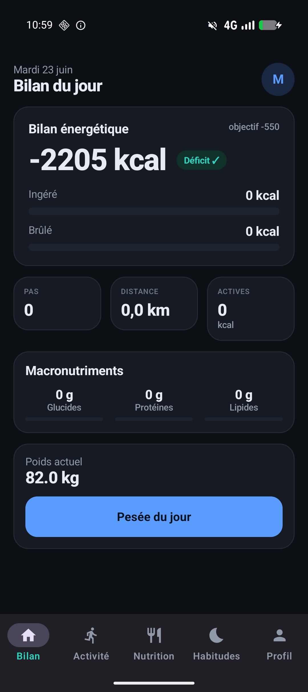
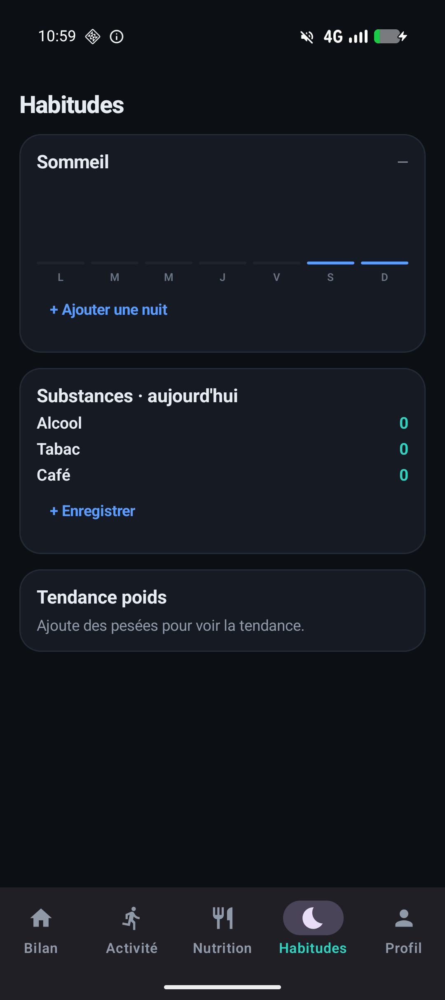
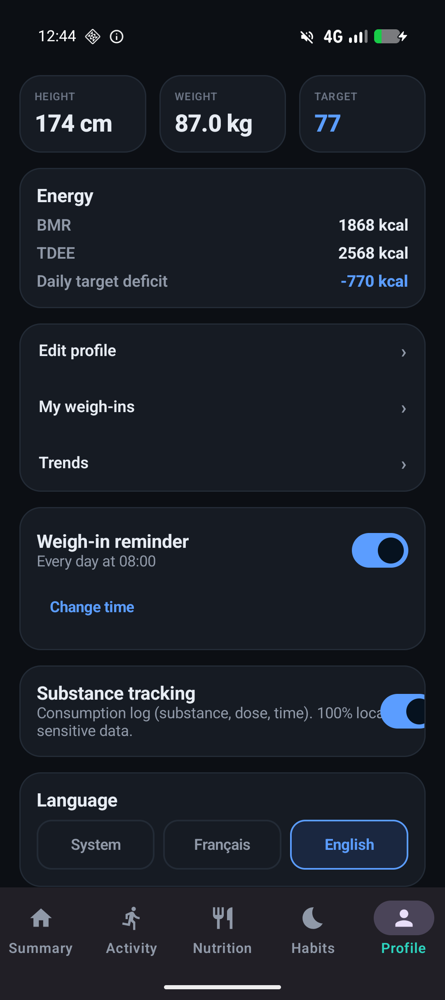
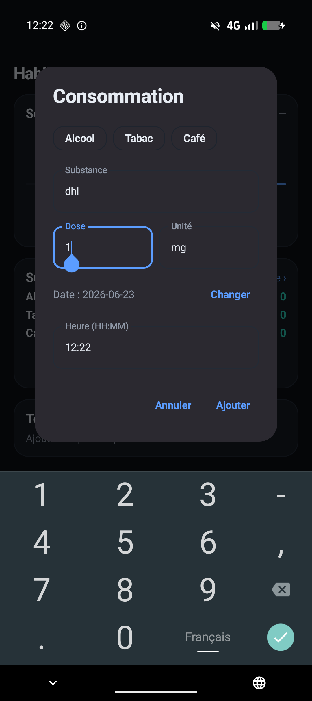

<div align="center">

# Poids

**Suivi santé & perte de poids — 100 % local, hors-ligne, sans Google.**

[](LICENSE)
[-3DDC84?logo=android&logoColor=white)](#)
[](#)
[](#)
[](#)

*Activité · Nutrition · Habitudes · Objectif perte de poids — tes données ne quittent jamais ton téléphone.*

</div>

---

## ✨ Pourquoi

Les apps de suivi (MyFitnessPal, Cronometer, FatSecret…) imposent un compte, du cloud, de la pub
ou un paywall sur le scan. **Poids** prend le contre-pied : tout est **local**, **hors-ligne**,
**sans publicité** et **sans dépendance Google** (installable sur Android dégooglisé / F-Droid).

## 📱 Aperçu

| Bilan du jour | Habitudes | Profil (English) | Saisie conso |
|:---:|:---:|:---:|:---:|
|  |  |  |  |

## 🚀 Fonctionnalités

- **Objectif** — profil (taille, poids, âge, sexe, niveau d'activité), calcul **BMR / TDEE**
  (Mifflin-St Jeor), déficit cible, **bilan énergétique du jour** (ingéré vs brûlé).
- **Activité** — podomètre (`TYPE_STEP_COUNTER`), suivi **GPS** (foreground service, `LocationManager`
  AOSP, vitesse/distance/dénivelé), calories via **MET** (Compendium 2024).
- **Nutrition** — **scan code-barres** (ZXing) → **Open Food Facts** (cache local write-through,
  rescan hors-ligne), recherche & aliment manuel, **photo de repas** (locale), calcul calories/macros.
- **Habitudes** — sommeil (durée, barres 7 jours), **suivi de consommation** (substance libre, dose,
  heure, back-dating) — optionnel, pensé pour la réduction des risques. Historique sur 12 mois.
- **Tendances** — poids (30 j), pas & sommeil (7 j).
- **Rappel de pesée** quotidien configurable (WorkManager + notification).
- **Bilingue** FR / EN, basculable dans les réglages.

## 🔒 Vie privée

- **100 % hors-ligne** — aucune donnée ne sort de l'appareil (seule exception : la requête
  Open Food Facts au moment d'un scan, mise en cache ensuite).
- **Aucun compte, aucun tracker, aucune pub, zéro Google Play Services.**
- Sauvegarde cloud désactivée (`allowBackup=false`).

## 🛠 Stack

`Kotlin` · `Jetpack Compose` (Material 3) · `Room` · `Hilt` · `Coroutines/Flow` · `Ktor` (OFF) ·
`WorkManager` · `ZXing` · `Coil`. Architecture **MVVM + repository**, multi-module
(`:domain` Kotlin pur · `:data` · `:app`). `targetSdk 36` · `minSdk 26`.

## 🏗 Build

```bash
./gradlew :app:assembleDebug    # APK debug
./gradlew :domain:test          # tests des calculs (BMR/TDEE/MET)
./gradlew installDebug          # installe sur un appareil connecté
```

Un SDK Android est requis (chemin dans `local.properties`, non versionné).

## 📦 F-Droid

Pensée FOSS dès le départ : voir [`fdroid-checklist.md`](fdroid-checklist.md). Build reproductible
(`dependenciesInfo` désactivé), licence GPL-3.0-only, aucune dépendance propriétaire.

## 📄 Licence

[GPL-3.0-only](LICENSE) © 2026
